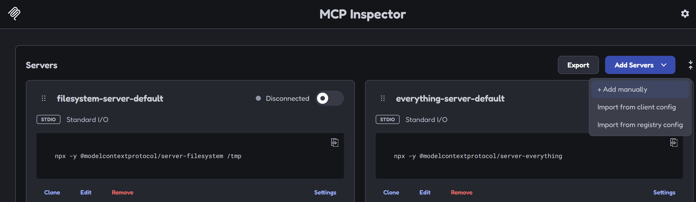
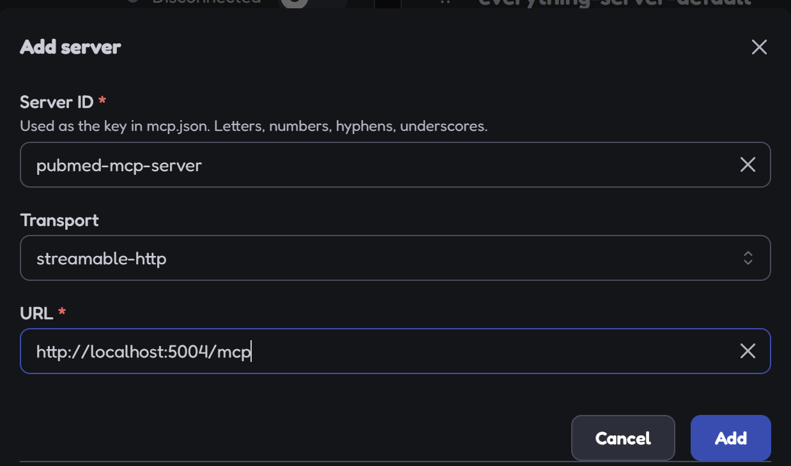
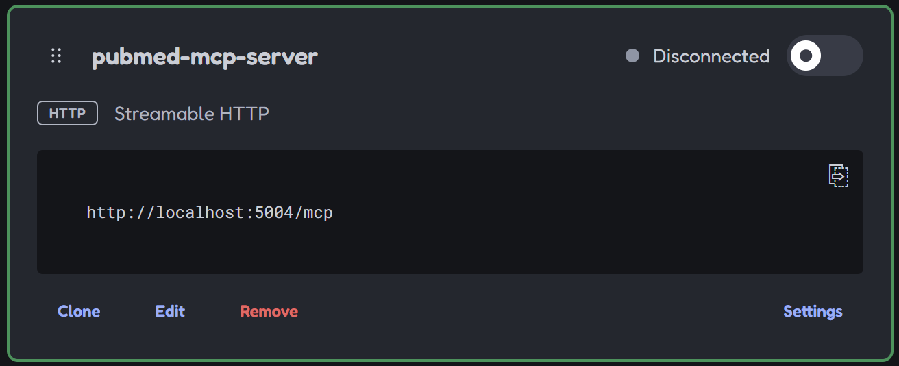
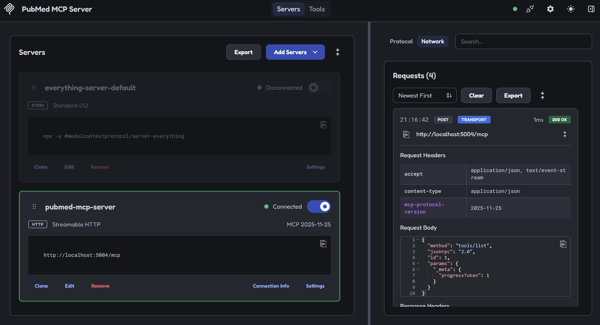
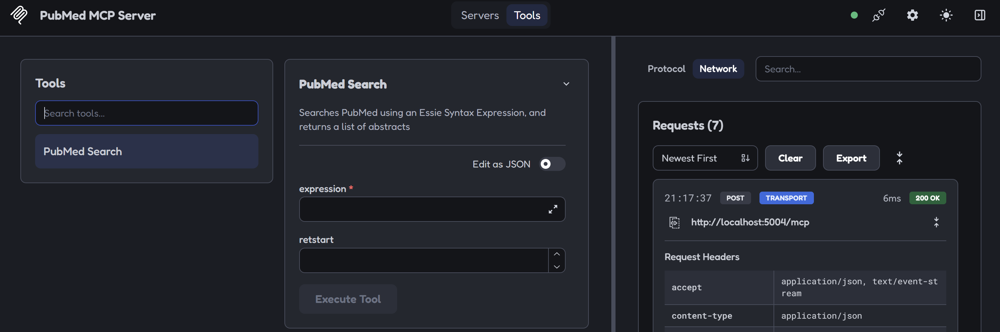
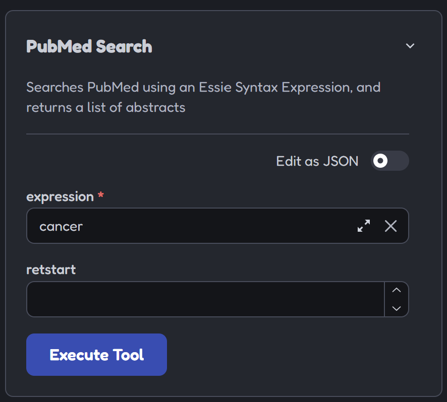
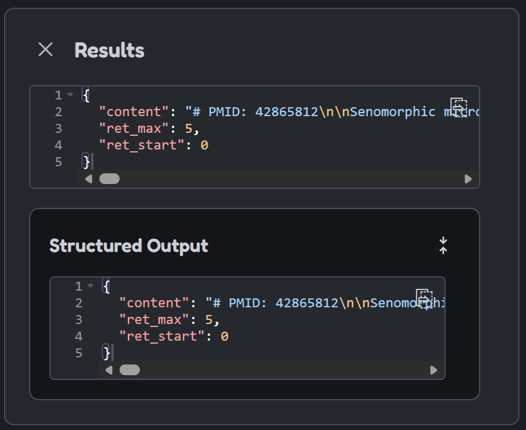

# MCP

This package contains an MCP wrapper for working with PubMed's API. It allows
an LLM to access a PubMed Search tool which returns a list of PubMed articles
with abstract for an LLM to read.

## Running

To start the PubMed MCP Server simple run the following command:

```shell
cargo run --package mcp
```

This will output the following in the Terminal:

```shell
     Running `target\debug\mcp.exe`
🟢 | Running at: 127.0.0.1:5004
```

This will start an axum server at port: `5004` on the localhost.

The port can be customized by passing in the port parameter:

```shell
cargo run --package mcp -- -p 3000
```

## MCP Protocol Inspector

The PubMed MCP Server can be tested by via the
[Model Context Protocol Inspector](https://modelcontextprotocol.io/docs/2026-07-28/tools/inspector):

Personally, I'd recommend utilizing web interface by running:

```shell
npx @modelcontextprotocol/inspector@latest
```

With both the MCP Server started and the Protocol inspector started, the PubMed
MCP Server can be added by:

1. Clicking on `Add Server` and choosing `+ Add manually` from the dropdown.
   

2. From the form show fill in:
   - `Server ID` with `pubmed-mcp-server`,
   - `Transport` with `streamable-http`
   - `URL` with `http://localhost:5004/mpc`

Then select `Add`


3. A `pubmed-mcp-server` tile will appear toggle `Disconnected` to get
   `Connected`
   
   

4. After connecting clicking on `Tools` will show the available tools for the
   MCP Server. Select the `PubMed Search` tool to view its arguments in a form:
   

5. Fill in `expression` field and click `Execute Tool`
   

6. The MCP tool results will be visible:
   
